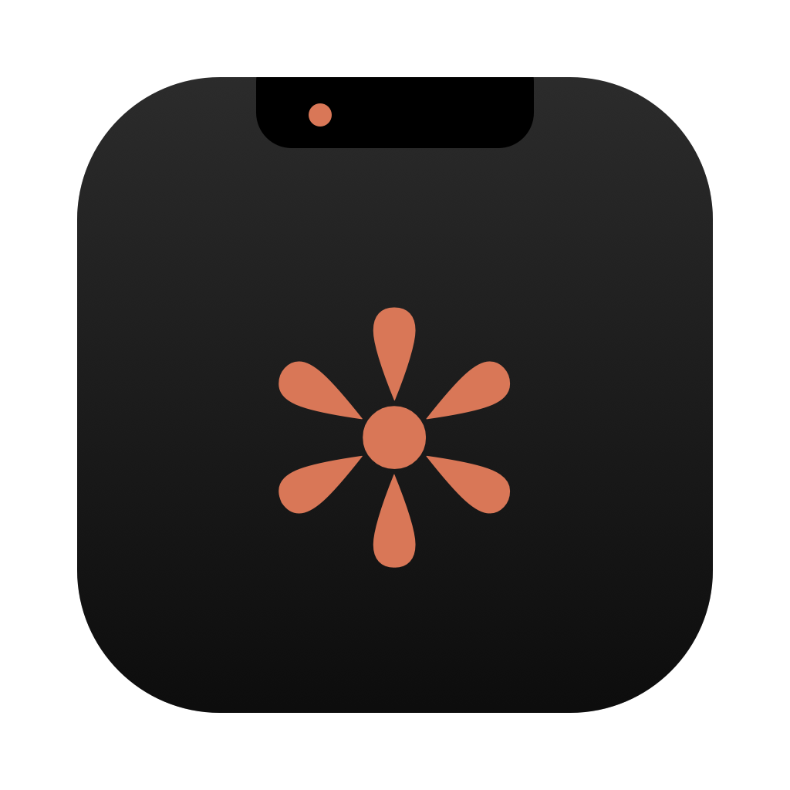

<p align="center">
  
</p>

<h1 align="center">NotchClaude</h1>

<p align="center">
  Criado e desenvolvido por <b>Carlos Danyel Silva Teixeira</b> · <a href="https://www.linkedin.com/feed/">LinkedIn</a>
</p>

Agendador de tarefas do **Claude Code** que mora no notch do Mac, no estilo do NotchNook.
Você passa o mouse no notch, ele abre, você escolhe a pasta, escreve o prompt, anexa imagens e agenda.
O Claude roda em segundo plano, invisível, usando o mesmo `claude --dangerously-skip-permissions` do Terminal,
e você acompanha tudo pelo notch ou abrindo a janela da tarefa.

---

## Requisitos

| Item | Como conferir |
| --- | --- |
| macOS 14 (Sonoma) ou mais novo | Menu  › Sobre este Mac |
| Claude Code instalado | `claude --version` no Terminal |
| Claude Code com login feito | rode `claude` uma vez e faça `/login` se pedir |

O app funciona melhor em Macs com notch, mas também aparece no topo central de telas sem notch.

---

## Instalação (pelo instalador)

### 📦 Onde está o instalador

O instalador pronto fica na pasta **`dist/`** deste projeto:

**➡️ [`dist/NotchClaude-1.0.0.dmg`](dist/NotchClaude-1.0.0.dmg)**

- No GitHub: abra o arquivo acima e clique em **Download** (ou em *View raw*).
- No seu Mac: `PROJETOS/NotchClaude/dist/NotchClaude-1.0.0.dmg`, ou rode `open dist` na pasta do projeto.
- Para gerar de novo: `make dmg` (o arquivo é recriado em `dist/`).

### Passo a passo

1. Abra o arquivo **`NotchClaude-1.0.0.dmg`**.
2. Arraste **NotchClaude** para a pasta **Aplicativos**.
3. Abra o NotchClaude pela pasta Aplicativos (ou pelo Spotlight).
4. Permita as **notificações** quando o macOS perguntar.
5. Pronto: passe o mouse no notch.

> **O macOS bloqueou a abertura?** O app é assinado localmente (não é notarizado pela Apple).
> Clique com o botão direito no app › **Abrir** › **Abrir**. Se o DMG veio de outro Mac, rode também:
> ```bash
> xattr -dr com.apple.quarantine /Applications/NotchClaude.app
> ```

### Abrir sempre com o Mac

Na primeira vez que é aberto a partir de **Aplicativos**, o NotchClaude se registra no login com um LaunchAgent
(`~/Library/LaunchAgents/app.notchclaude.NotchClaude.plist`):

- abre sozinho quando você liga o Mac ou faz login;
- se fechar de forma inesperada, o macOS reabre em ~10 s;
- se você mandar **Encerrar**, ele continua fechado até o próximo login.

O macOS pode mostrar o aviso *"Itens em segundo plano adicionados"*, e isso é normal.
Para desligar: **Ajustes do NotchClaude › Sistema › Abrir ao iniciar o Mac**.

---

## Instalação (compilando o código)

Precisa do Xcode 15 ou mais novo (ou das Command Line Tools com Swift 5.9+).

```bash
make test      # roda os testes
make dmg       # gera build/NotchClaude.app e dist/NotchClaude-1.0.0.dmg
make install   # copia para /Applications e abre
```

---

## Como usar

### Notch
- **Passe o mouse** no notch para abrir. Ao tirar o mouse, ele fecha (com feedback tátil, igual ao NotchNook).
- **Tarefas**: à esquerda, o que está rodando agora (ou o limite, ou a próxima tarefa); à direita, a lista com status.
- **Nova**: cria uma tarefa.
- **Mídia**: player do Spotify e espelho da câmera (veja abaixo).
- No topo à direita ficam o uso do **limite de 5h** e do **limite semanal** em %, sempre da conta logada no
  Claude Code: o app consulta o uso da conta a cada 2 minutos e sempre que o notch abre.
- Fechado, o notch mostra o **logo do Claude** com uma **bolinha de status**: verde pulsando (executando),
  âmbar (na fila), vermelha (tokens esgotados ou tarefa com erro, até você abrir o notch), azul (agendada)
  e cinza (nada pendente). Do outro lado aparece o tempo rodando, ou o relógio de quando os tokens liberam.
- Ao terminar, aparece um *quick peek* (“Tarefa concluída”, “Tokens esgotados”…) e uma notificação.

### Spotify e câmera (aba Mídia)
- **Spotify**: capa, música, artista, botões anterior / tocar-pausar / próxima, **volume** e **barra de progresso**
  (arraste para avançar ou voltar na música). Com o Spotify aberto, a **capa com o equalizador** aparece do lado
  direito do notch fechado; o equalizador se mexe enquanto a música toca.
  Na primeira vez, o macOS pede para o NotchClaude **controlar o Spotify** (Automação). Sem essa permissão a
  música ainda aparece, mas sem capa e sem os botões.
- **Espelho**: clique em **Ligar câmera** para se ver antes de uma call. A câmera desliga sozinha quando você
  sai da aba ou o notch fecha, e nada é gravado.
- Os dois podem ser desligados em **Ajustes › Spotify** e **Ajustes › Câmera**.

### Criar uma tarefa
1. **Pasta**: o Claude abre exatamente nessa pasta e carrega o `CLAUDE.md`, as skills (`.claude/skills`),
   os comandos (`.claude/commands`), os MCPs (`.mcp.json`) e os ajustes dela, além dos seus globais.
   As skills encontradas aparecem como atalhos: clique para inserir `/nome-da-skill` no prompt.
2. **Prompt**: escreva como faria no chat.
3. **Imagens**: arraste para o notch, cole com **⌘V** ou clique em **+**. Elas vão para o Claude como no chat.
   Outros arquivos são enviados pelo caminho. Se você arrastar uma **pasta**, ela vira a pasta de trabalho.
4. **Modelo** (opcional): Padrão (o configurado no seu Claude Code), **Fable 5.1**, **Opus 5.5**, **Sonnet 5.5**
   ou **Haiku 5.5**. **Esforço** também é opcional.
   Se a conta precisar de créditos de uso para o modelo escolhido, só aquela tarefa falha, com o aviso
   “Este modelo exige créditos de uso”, e a fila continua normalmente.
5. **Quando**: Agora, +30 min, +1 h, Amanhã 9h ou uma data. **Repetir**: a cada hora, todo dia, dias úteis, toda semana.
6. **Rodar/Agendar** (ou **⌘↩**).

### Status

| Status | Significado |
| --- | --- |
| Agendada | esperando o horário |
| Aguardando | na fila, esperando uma vaga (padrão: 1 tarefa por vez) |
| Executando | o Claude está trabalhando em segundo plano |
| Tokens esgotados | o limite de 5h ou semanal acabou; roda sozinha quando liberar |
| Concluída | terminou com sucesso |
| Erro | terminou com erro (veja o motivo na janela da tarefa) |
| Cancelada | você parou ou cancelou |

### Limite de 5h / semanal
- Quando o Claude avisa que o limite acabou, o app registra **a hora exata da liberação** que o próprio Claude informa.
- Todas as tarefas que vencerem nesse período ficam como **Tokens esgotados** e **ninguém roda** até liberar.
- Na liberação, as atrasadas rodam **na ordem do horário agendado**.
- Se uma tarefa for cortada no meio, ela **continua a mesma sessão** de onde parou (`--resume`), com a mensagem
  configurável em Ajustes.
- O Mac em repouso não perde nada: ao acordar, o que atrasou entra na fila. Enquanto uma tarefa roda,
  o Mac não entra em repouso por inatividade.

### Acompanhar
Clique numa tarefa (ou em **Acompanhar**) para abrir a janela com o processo ao vivo: o prompt, as imagens,
o texto do Claude chegando, cada ferramenta (Bash, Edit, Read, Skill…) com entrada e saída, o pensamento e o
resumo final (duração, turnos, tokens, custo). Nessa janela você também pode:
- **Responder** e continuar a mesma sessão, com anexos;
- **Parar**, **Rodar do zero**, **Mostrar pasta**;
- **Abrir no Terminal**: abre a mesma sessão no Claude interativo (`claude --resume …`).

### Atalhos por URL
`notchclaude://open`, `notchclaude://new`, `notchclaude://new?dir=~/Projetos/site`, `notchclaude://settings`,
`notchclaude://media`, `notchclaude://mirror` (abre a aba Mídia já com a câmera ligada)
(dá para usar no Raycast, Alfred ou no app Atalhos).

---

## Ajustes
Caminho do `claude` (detecta sozinho), pular permissões, modelo e esforço padrão, tarefas simultâneas,
argumentos extras (ex.: `--add-dir ~/Design`), mensagem de continuação após o limite, abrir ao passar o mouse,
feedback tátil, manter aberto enquanto digita, telas sem notch, logo e status com o notch fechado,
player do Spotify, capa da música no notch fechado, espelho da câmera, abrir com o Mac e notificações.

---

## Usando junto com o NotchNook
Os dois apps usam o notch. Se os dois estiverem abertos, os dois abrem ao passar o mouse.
Escolha uma das opções:
- feche o NotchNook; ou
- desative **Abrir ao passar o mouse** em um deles (no NotchClaude, aí ele abre com **clique** no notch).

---

## Segurança
As tarefas rodam com `--dangerously-skip-permissions`: o Claude edita arquivos e executa comandos sem pedir
confirmação, exatamente como quando você o abre assim no Terminal. Use em pastas de sua confiança.
Isso pode ser desligado em Ajustes; nesse caso, o modo usado é `acceptEdits`.

Para mostrar o uso de 5h e semanal, o app lê o login do Claude Code no Keychain (`Claude Code-credentials`) e
consulta só `api.anthropic.com/api/oauth/usage`. O token não é salvo nem renovado pelo NotchClaude.

---

## Onde ficam os dados
`~/Library/Application Support/NotchClaude/`
- `store.json`: tarefas, histórico e estado do limite
- `logs/`: registro completo de cada execução (stream do Claude)
- `attachments/`: imagens e arquivos anexados

## Desinstalar
```bash
pkill -x NotchClaude
rm -f ~/Library/LaunchAgents/app.notchclaude.NotchClaude.plist
rm -rf /Applications/NotchClaude.app ~/Library/Application\ Support/NotchClaude
defaults delete app.notchclaude.NotchClaude
```

---

## Arquitetura

```
Sources/NotchClaude
├── App/           ponto de entrada, AppDelegate e AppContainer (injeção de dependências)
├── Core/
│   ├── Models/        tarefas, execuções, status, recorrência, uso e limite
│   ├── Persistence/   TaskStore (JSON), AppSettings, caminhos
│   ├── Execution/     ClaudeProcess (processo + stream), RunSession, RunManager,
│   │                  TranscriptBuilder (parser do stream-json), detecção de limite
│   ├── Scheduling/    Scheduler (fila, horários, limite e liberação)
│   └── Services/      ambiente do shell, anexos, skills da pasta, notificações, login,
│                      Spotify (notificação + AppleScript) e câmera (AVFoundation)
├── Notch/         painel do notch (AppKit + SwiftUI), forma, live activity, abas, mídia
├── Windows/       janela de acompanhamento e ajustes
└── Components/    componentes visuais reutilizáveis
```

Cada execução é `claude -p --input-format stream-json --output-format stream-json --verbose
--include-partial-messages --dangerously-skip-permissions --session-id <uuid>` na pasta escolhida, com o
prompt e as imagens enviados como mensagem do usuário. O app lê o stream em tempo real, inclusive os eventos
`rate_limit_event` e `usage_limit_reached`, que dizem qual limite acabou e quando ele libera.

---

## Autor

**Carlos Danyel Silva Teixeira**, criador e desenvolvedor do NotchClaude (código e ícone).

- LinkedIn: [Carlos Danyel Silva Teixeira](https://www.linkedin.com/feed/)
- GitHub: [@CarlosDanyel](https://github.com/CarlosDanyel)

---

## Licença

Distribuído sob a licença **MIT com cláusula de atribuição**. Veja o arquivo [`LICENSE`](LICENSE).
Você pode usar, modificar e redistribuir o NotchClaude livremente, desde que:

- mantenha o aviso de copyright e o texto da licença;
- dê **crédito visível ao criador, Carlos Danyel Silva Teixeira** ([LinkedIn](https://www.linkedin.com/feed/)), com link para o
  projeto original (https://github.com/CarlosDanyel/NotchClaude), por exemplo no README, na tela "Sobre" ou na documentação.

Isso vale também para o ícone do app ([`assets/icon.png`](assets/icon.png)).
